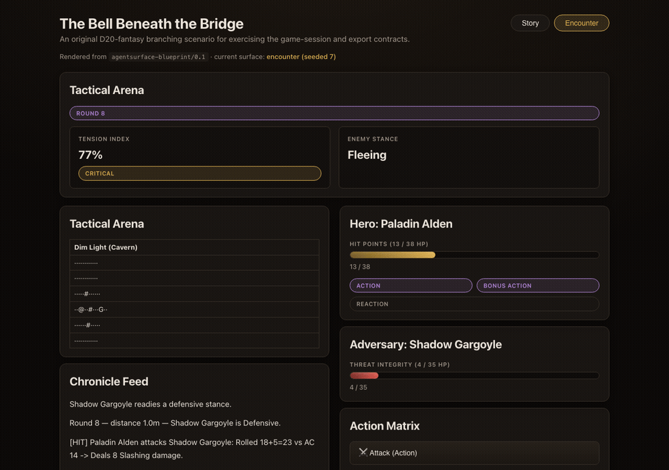

# AI Dungeon Master

[](https://github.com/RemyLoveLogicAI/ai-dungeon-master/releases)
[](pyproject.toml)
[](LICENSE)
[](https://github.com/RemyLoveLogicAI/ai-dungeon-master/actions/workflows/ci.yml)



**[Try it locally](#try-the-browser-demo)** · **[Install and run](#install-and-run)** ·
**[Source](https://github.com/RemyLoveLogicAI/ai-dungeon-master)**

A small, dependency-free Python foundation for deterministic D20 combat and
branching fantasy encounters. Simulate a fight, export a validated surface
blueprint, and hand it to an agent without giving the renderer executable game
logic.

## What is included

- Deterministic D20 combat with seeded and scripted dice sources.
- Replayable attack events and versioned, validated encounter logs.
- A domain-neutral branching-scene model with MCP Games and AgentSurface JSON
  exporters.
- A stance-based enemy AI, procedural audio, terminal encounter UI, and a static
  browser demo.

## Install and run

After the first PyPI release, run the packaged demo with `uvx` (Python 3.10+):

```bash
uvx ai-dungeon-master
```

## Try the browser demo

The intended public URL is [GitHub Pages](https://remylovelogicai.github.io/ai-dungeon-master/).
It currently returns 404 because Pages is not enabled for this repository.
Enable **Settings → Pages → Build and deployment → Source: GitHub Actions**,
then push to `main`. Until then, use the local prototype:

```bash
uv run python web/build_demo.py
uv run python -m http.server 8765 --directory web
# open http://127.0.0.1:8765/
```

`#scene=<id>` and `#encounter` open individual views. The browser client is an
experimental, local-only prototype; it renders a supported subset of the DSL
using safe text APIs and returns submitted intents as visible, copyable JSON
envelopes. It does not execute combat actions or provide a hosted gameplay
session.

## Experimental AgentSurface handoff

The Python exporters emit the AgentSurface DSL v0.1 blueprint. In an agent
workflow, the agent can pass that JSON to AgentSurface's `validate_blueprint`
and `render_surface` MCP tools. The HTML returned by the renderer is
self-contained and ephemeral; closing it discards the surface. Button intents
return as copyable envelopes for the agent to interpret. This repository adds
no AgentSurface MCP client, live transport, persistence, or production host.

The rest of the package remains usable independently: simulation, scenario
adapters, replayable combat events, validated logs, and terminal output run
locally without a model provider. See [Architecture](docs/architecture.md),
[Integrations](docs/integrations.md), and the [roadmap](docs/roadmap.md).

## From the command line

Run the combat demo:

```bash
python combat_runner.py
```

Make a run reproducible — pass a seeded dice source and every attack replays
from its recorded rolls:

```python
from combat_runner import run_simulated_encounter
from d20_rules import SeededDiceSource

run_simulated_encounter(dice=SeededDiceSource(7))
```

Record a single attack and replay it from the dice it consumed:

```python
from combat_log import record_entry
from d20_rules import AttackRequest, DamageType, SeededDiceSource

request = AttackRequest(
    attacker="Paladin Alden",
    target="Shadow Gargoyle",
    attack_modifier=5,
    target_ac=14,
    damage_dice_count=2,
    damage_die_sides=6,
    damage_modifier=3,
    damage_type=DamageType.SLASHING,
)

entry, resolution = record_entry(request, dice=SeededDiceSource(7))
print(entry.event.rolls)  # the dice behind the result
print(entry.replays())    # True: replays from the rolls alone
```

Persist an encounter as a versioned, validated envelope and read it back:

```python
from combat_log import CombatLog, load_log, save_log, trim_log, verify_log

log = CombatLog(entries=(entry,))
save_log(log, "encounter.json")       # durable, deterministic JSON
restored = load_log("encounter.json")  # strict validation on the way back in
print(verify_log(restored))           # True: the reloaded log still replays
print(trim_log(restored, 100).dropped)  # retention: entries dropped, if any
```

Records deliberately carry only the numbers and fictional names attached to an
attack: no prompts, player context, or executable content cross the boundary.

Validate that envelope against the published schema, with or without this
repository's code:

```bash
# the artifact ships with the package, so a consumer can read it directly
python -c "import combat_schema; print(combat_schema.schema_path())"
```

```python
from combat_log import load_log

# the in-repo readers always run; this adds the published schema on top
log = load_log("encounter.json", validate_schema=True)
```

The schema check raises `combat_schema.SchemaUnavailableError` when the optional
`jsonschema` extra (`pip install 'ai-dungeon-master[schema]'`) is absent, so a
requested check is never reported as one that passed. The runners ask for a
validator before they start, so `--validate-schema` refuses with exit status 2
without printing a round or writing the log.

Run the generative terminal surface (TUI), save the encounter, and resume it:

```bash
python tui_runner.py
python tui_runner.py --log encounter.json                  # a durable run
python tui_runner.py --log encounter.json --resume         # continue it later
python tui_runner.py --log encounter.json --resume --validate-schema
```

The runner rewrites the envelope at the end of every round, so an interrupted
session resumes from the last completed one, and an existing log is never
replaced without `--resume` or `--overwrite`. A resume rebuilds hit points,
distance, the next round, and the enemy's remaining spell slots from the
recorded attacks. What the envelope does not carry is reported on screen rather
than guessed; see `RESUME_NOTES` in `tui_runner.py`.

Create and advance a story session from Python:

```python
from game_foundation import STARTER_SCENARIO, choose, start_session

session = start_session(STARTER_SCENARIO)
session = choose(session, STARTER_SCENARIO, "follow_the_bell")
print(session.current_scene)  # sunken_shrine
print(session.events)         # ordered choice_selected event(s)
```

Export the same scenario for the other projects:

```python
from game_foundation import (
    STARTER_SCENARIO,
    to_agentsurface_v01,
    to_mcp_games_v1,
)

game_definition = to_mcp_games_v1(STARTER_SCENARIO)
surface_blueprint = to_agentsurface_v01(STARTER_SCENARIO)
```

The D20 examples use original, system-neutral fantasy content; this is not a
complete D&D 5e ruleset. The terminal UI is a local client. The `web/` page is a
separate local prototype, not the AgentSurface renderer or a hosted combat
service. See the SRD licensing boundary and provenance source in
[Architecture](docs/architecture.md).

## Development

```bash
uv sync --dev
uv run pytest -v
uv run ruff check .
uv run mypy
uv run pytest --cov --cov-report=json && uv run python coverage_gate.py
```

The CI workflow runs Ruff and pytest on Python 3.10–3.14 with `--cov`, so the
total `fail_under` gate in `pyproject.toml` applies to a local
`uv run pytest --cov` too. That gate cannot see one module collapsing while the
others carry the average, so `coverage_gate.py` applies a floor per module on
top of it and refuses a report older than the code it describes. No runtime
dependencies are added by the foundation: `jsonschema` is a development and
optional-extra dependency, used only to validate logs against the published
schema.

## CI/CD

- **CI** ([ci.yml](.github/workflows/ci.yml)): the lockfile is checked against
  `pyproject.toml`, Ruff lints, pytest runs under the total coverage gate on
  every supported Python version, the per-module floors are enforced on one
  pinned interpreter, and a build job installs the wheel into a throwaway venv
  and runs the documented `ai-dungeon-master` command plus the two legacy
  console entry points.
- **Release** ([release.yml](.github/workflows/release.yml)): a version tag
  builds and smoke-tests distributions once; the GitHub Release still receives
  those artifacts after the build, independently of PyPI availability. A
  separate OIDC chain publishes to TestPyPI, then PyPI only after TestPyPI
  succeeds. Configure PyPI trusted publishers for the `testpypi` and `pypi`
  environments before publishing.

