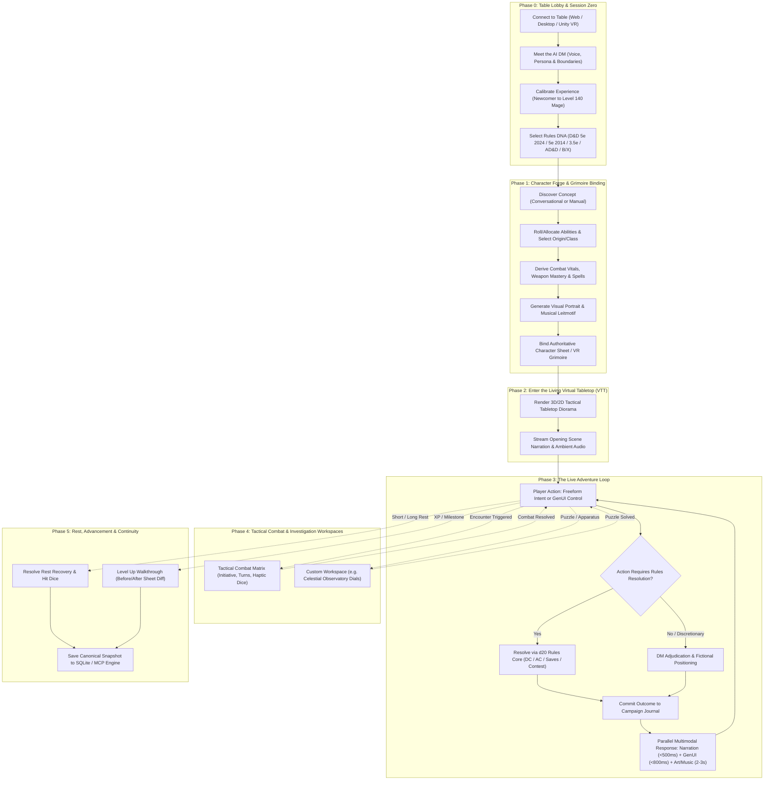
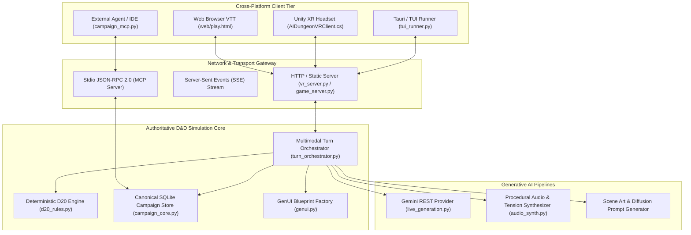
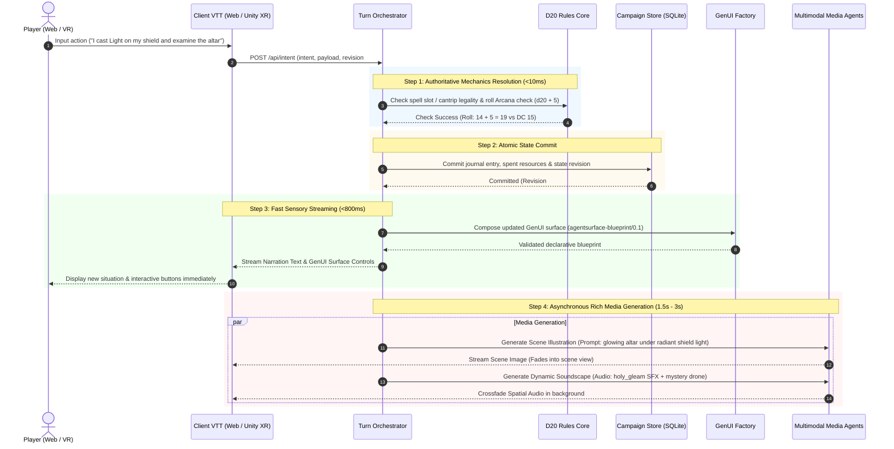

# D&D Online VTT: Complete Player Journey, System Architecture & Generative Process

## 1. Executive Summary

This document establishes the end-to-end integration mapping the AI Dungeon Master platform to the modern **D&D Online Virtual Tabletop (VTT)** ecosystem (combining the best paradigms of D&D Beyond character management, Roll20/Foundry tactical grid diorama, and live multi-agent table coordination).

Every player decision orchestrates a synchronized response across **Story**, **Visuals**, **Spatial Audio**, **Dynamic GenUI**, and **Deterministic Rules**, supporting browser clients, desktop runners, and immersive Unity VR headsets.

---

## 2. End-to-End Player Experience Journey

---

## 3. High-Level System Architecture & Client Topology

---

## 4. Turn-by-Turn Multimodal Execution Sequence

---

## 5. Virtual Tabletop UI Layout Architecture

The user interface adapts dynamically across five primary viewports:

| Viewport | Primary Purpose | Key Components |
| :--- | :--- | :--- |
| **1. Tactical Battlemap / Diorama** | 2D/3D visual spatial state | Grid tiles, creature tokens, line-of-sight, terrain covers, range rings |
| **2. Interactive Character Grimoire** | Persistent player status | HP progress bar, Armor Class, Spell Slots, Weapon Masteries, Inventory |
| **3. Narrative Chronicle & Voice** | The DM's living story log | Formatted prose, dialogue bubbles, DM TTS voice playback, roll breakdowns |
| **4. Contextual GenUI Action Tray** | Dynamic situational controls | Action/Bonus Action/Reaction matrix, puzzle dials, dialogue options |
| **5. Physicalized 3D Dice Tray** | Tactile resolution | Real-time d20 physics simulation, haptic rumble, critical fanfare audio |
