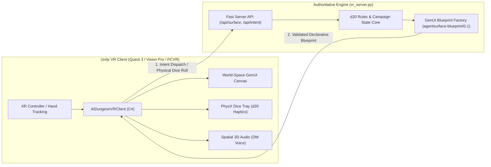

# Production VR Architecture: AI Dungeon Master for Unity XR

## 1. Executive Summary

A stable, production-grade VR experience cannot rely on naive HTTP polling or dynamic C# script compilation. VR headsets enforce rigid real-time constraints:
* **Frame Timing:** Rock-solid 90 Hz (11.1ms per frame) or 120 Hz (8.33ms per frame) to prevent simulator sickness.
* **Garbage Collection:** Zero GC allocation per frame on mobile chipsets (Snapdragon XR2 Gen 2 / Quest 3).
* **Network Authority:** The VR headset is an input/output sensory device (eyes, ears, hands). The authoritative D&D rules engine, campaign persistence, and generative models reside on the backend.

---

## 2. System Architecture

---

## 3. Diegetic VR Tabletop Metaphors

Rather than flat 2D floating windows, production VR maps the generative UI into physicalized, diegetic objects:

1. **The Adventurer's Grimoire (Character Sheet):**  
   Held in the player's non-dominant hand or resting on the table. Flips open to show current HP, AC, spell slots, and inventory.
2. **The Living Tabletop Diorama (Tactical Grid):**  
   The tactical map (`TacticalGrid`) renders as 3D miniatures and terrain props on an oak table in front of the player.
3. **Physicalized Haptic Dice Tray:**  
   Players physically grab, shake, and roll a 3D d20 with controller haptics. When the die settles, the face value is captured and dispatched to the engine via `PHYSICAL_DICE_ROLL`.
4. **Spatial DM Presence:**  
   The DM speaks from a distinct point in 3D space across the table, anchoring immersion.

---

## 4. Performance & Memory Contract

* **Prefab Pooling:** All dynamic GenUI cards, stats, and buttons are pooled in memory on scene awake. Instantiation during gameplay is prohibited.
* **Declarative Schemas:** Blueprints strictly adhere to `agentsurface-blueprint/0.1`. The Unity client contains zero game logic; it purely maps JSON components into pre-built UI primitives.
* **Fail-Closed Fallback:** If a network interruption occurs, the client retains the last authoritative state and offers an in-world retry button.
